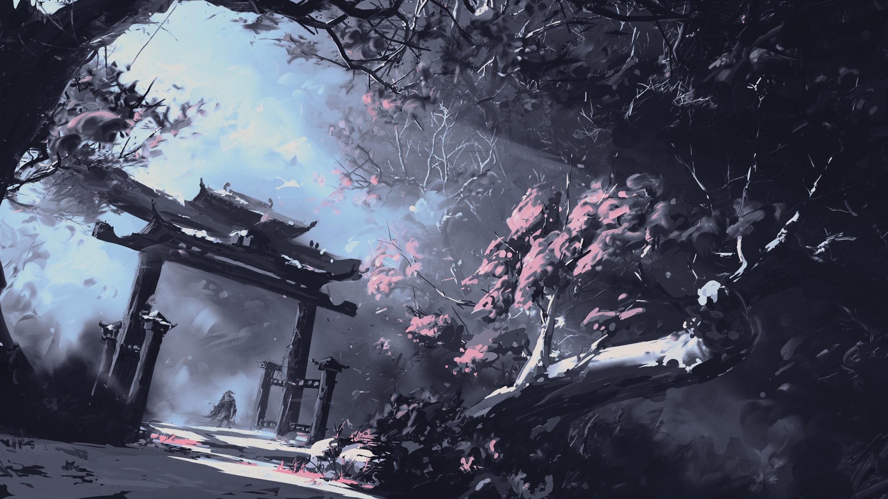

# Japan Sakura 🌸🏯

A slick, modern Japanese cherry blossom theme for [Omarchy](https://omarchy.org/) Linux with Hyprland. Designed with midnight sumi-e ink tones, vivid sakura pink highlights, translucent frosted glass surfaces, and breathtaking 4K scenic Japanese landscapes.



---

## ✨ Features

- **Slick Frosted Glass Surfaces**: Translucent Quickshell status bar (`background-alpha = 0.65`), notification cards, launcher, menus, and flyouts rendered with multi-pass Wayland Kawase background blur.
- **Modern Sakura Color Palette**:
  - **Midnight Ink Canvas**: Deep obsidian night background (`#14121A`) with subtle twilight undertones.
  - **Electric Sakura Accents**: Vibrant cherry blossom pink (`#FF75A0`), plum blossom (`#E58FB4`), and lantern gold (`#F6C177`).
  - **Crisp Readability**: Silky blossom-white foreground (`#F5E6EB`) paired with Fuji-stream cyan (`#7DCFFF`) and spring matcha green (`#8BD5CA`).
- **Hyprland Window Geometry**:
  - **Squircle Corners**: 12px smooth window curvature (`rounding_power = 2`).
  - **Glowing Sakura Gradient Borders**: 2px border featuring a smooth 45° gradient from electric cherry blossom pink to plum bloom and crisp sky cyan.
  - **Deep Ambient Shadows**: 26px soft shadow range for floating and tiled windows.
  - **Multi-Pass Blur**: Kawase dual-filter background blur with vibrancy, contrast tuning, and popup blur.
- **Terminal Translucency**: Configured out of the box with `0.88` background opacity and blur for Ghostty, Kitty, and Alacritty.
- **Curated 4K/UHD Wallpapers**: Bundled with 5 high-resolution Japanese sakura landscapes:
  - `01-sakura-gate.jpg` — Japanese Torii gate framed by cherry blossom blooms under twilight.
  - `02-sakura-trees-river.jpg` — Serene cherry trees blooming along a tranquil reflective river.
  - `03-sakura-fuji-night.png` — Majestic Mount Fuji under a starry night sky with cherry blossom branches.
  - `04-sakura-mountain-range.jpg` — Traditional pagoda overlooking misty mountain peaks draped in pink blossoms.
  - `05-sakura-tokyo-tower.jpg` — Modern Tokyo cityscape with Tokyo Tower glowing amidst sakura petals.

---

## 📦 Installation

### Option 1: Local Setup (Recommended)

Clone or link the theme into your Omarchy user themes directory:

```bash
git clone https://github.com/pandaind/omarchy-japan-sakura.git ~/.config/omarchy/themes/japan-sakura
omarchy theme set "Japan Sakura"
```

### Option 2: CLI One-Liner (if hosted in a repo)

```bash
omarchy theme install https://github.com/pandaind/omarchy-japan-sakura.git
```

---

## 🚀 Usage

### Apply the Theme
```bash
omarchy theme set "Japan Sakura"
# or
omarchy theme set japan-sakura
```

### Cycle Wallpapers
```bash
omarchy theme bg next
```

### Open Graphical Theme Switcher
```bash
omarchy-theme-switcher
```

---

## 📁 Theme Structure

```text
omarchy-japan-sakura/
├── colors.toml         # Base palette and semantic color definitions
├── shell.toml          # Omarchy shell surfaces (bar, popups, menus, notifications)
├── hyprland.lua        # Hyprland window decorations, blur passes, and layer rules
├── ghostty.conf        # Ghostty terminal styling (opacity + blur)
├── kitty.conf          # Kitty terminal styling (opacity + blur)
├── alacritty.toml      # Alacritty terminal styling (opacity + blur)
├── icons.theme         # System icon theme (Yaru-magenta-dark)
├── preview.png         # High-resolution theme preview image
└── backgrounds/        # Curated 4K/UHD Japanese wallpapers
    ├── 01-sakura-gate.jpg
    ├── 02-sakura-trees-river.jpg
    ├── 03-sakura-fuji-night.png
    ├── 04-sakura-mountain-range.jpg
    └── 05-sakura-tokyo-tower.jpg
```
